  

# 🔄 Awesome Active Directory & User Synchronization 🚀

  
  
  
  
  
  

  <b>A curated catalog of enterprise SaaS platforms and self-hosted open-source software for Active Directory (AD), Microsoft Entra ID, OpenLDAP, SCIM 2.0 provisioning, and hybrid identity user synchronization.</b>

  🌟 <i>Star this repository if you find it helpful!</i> 🌟

---

## 📑 Table of Contents

- [📊 Sector Overview & Market Dynamics](#-sector-overview--market-dynamics)
- [☁️ SaaS & Hosted Enterprise Platforms](#️-saas--hosted-enterprise-platforms)
- [⚡ Open-Source Synchronization Engines & IAM Platforms](#-open-source-synchronization-engines--iam-platforms)
- [🛠️ Developer Libraries & Building Blocks](#️-developer-libraries--building-blocks)
- [📈 Star History](#-star-history)
- [🤝 How to Contribute](#-how-to-contribute)
- [💖 Support & Sponsorship](#-support--sponsorship)
- [⚖️ Disclaimer & Architecture Taxonomy](#️-disclaimer--architecture-taxonomy)

---

## 📊 Sector Overview & Market Dynamics

The global **Identity and Access Management (IAM)** and directory synchronization sector is valued at **$20B–$23B (2024–2025)** and is projected to expand beyond **$42B+ by 2030** at a **~13–15% CAGR**. 

Market concentration follows a distinct **barbell structure**:
- **Consolidated Enterprise Core (Top Heavy)**: Hyperscalers and dominant IAM conglomerates—chiefly **Microsoft** (commanding the largest enterprise directory footprint via Entra ID and Active Directory) and **Okta**—capture the lion's share of enterprise-wide single sign-on (SSO) and hybrid directory bridges.
- **Dynamic & Fragmented Ecosystem**: Beneath the core suites lies a diverse, competitive ecosystem of specialized engines handling Privileged Access Management (PAM), IT service desk orchestration, SCIM 2.0 gateways, and self-hosted directory connectors for multi-cloud and sovereign infrastructure.

---

## ☁️ SaaS & Hosted Enterprise Platforms

The table below lists leading commercial SaaS and cloud-managed solutions for Active Directory user synchronization, sorted by company valuation / market capitalization (descending).

| 🏢 Platform | 🏷️ Parent / Vendor | 💰 Valuation / Market Cap / Revenue | 💳 Starting Pricing Tier | 🎁 Free Tier Limits / Free Trial | 🎯 Primary Sync & Integration Focus |
|---|---|---|---|---|---|
| [**Microsoft Entra Connect Sync / Cloud Sync**](https://learn.microsoft.com/en-us/entra/identity/hybrid/whatis-hybrid-identity) | Microsoft | $3.1+ Trillion (Market Cap) / $245B+ ARR | **$6.00 / user / month** (Entra ID P1 standalone; included with Microsoft 365 Business Premium / E3 / E5) | **Free tier available**: Entra ID Free tier includes core user/directory synchronization and password hash sync up to 500,000 directory objects; 30-day free trial for P1/P2 (up to 100 licenses). | Hybrid identity sync between on-premises Active Directory and Entra ID (PHS, PTA, Cloud Sync agent). |
| [**Google Cloud Directory Sync (GCDS)**](https://support.google.com/a/answer/106368) | Alphabet (Google) | $2.1+ Trillion (Market Cap) / $350B+ ARR | **$7.00 / user / month** (Google Workspace Business Starter; GCDS software is free of charge) | **Free tier available**: Cloud Identity Free tier includes directory management for up to 50 users (requestable increase); 14-day free trial for Google Workspace (up to 10 users). | One-way directory sync from AD/LDAP to Google Workspace and Cloud Identity domains. |
| [**CyberArk Identity**](https://www.cyberark.com/products/identity-and-access-management/) | CyberArk (Palo Alto Networks) | $20.6B–$22.5B (Market Cap) / $1.0B+ ARR | **$2.00 / user / month** (Workforce Identity SSO/MFA baseline tier; quote-based annual enterprise billing) | **Free trial only**: 14-day proof-of-concept (POC) sandbox trial via sales engagement (no permanent free tier). | Privileged access management, adaptive SSO/MFA, and secure directory sync across enterprise infrastructure. |
| [**Okta AD Agent**](https://www.okta.com/products/active-directory-integration/) | Okta | $15.3B–$16.1B (Market Cap) / $2.6B+ ARR | **$6.00 / user / month** (Starter Plan with SSO and Universal Directory; $1,500/year minimum contract spend) | **Free tier & trial**: 30-day full-feature free trial (up to 10 users); permanent Developer Edition free for up to 10 users (deactivates if inactive for 90 days). | Cloud directory plane with on-premises AD delegated authentication, user provisioning, and bi-directional attribute sync. |
| [**Ping Identity / ForgeRock**](https://www.pingidentity.com/) | Ping Identity (Thoma Bravo) | $5.1B (Combined Acquisition Valuation: $2.8B Ping + $2.3B ForgeRock) / ~$1B ARR | **$3.00 / user / month** (Workforce Essential plan; billed annually, typical enterprise deployment thresholds) | **Free trial only**: 30-day free trial of PingOne cloud platform (requires corporate email; no permanent free tier). | Complex enterprise identity linking, bulk federation (SAML/OIDC), and hybrid directory bridges. |
| [**Freshworks Directory Services (Orch)**](https://www.freshworks.com/apps/freshservice/microsoft_active_directory_-_orch/) | Freshworks | $3.45B–$4.9B (Market Cap) / $700M+ ARR | **$19.00 / agent / month** (Freshservice Starter plan, billed annually; includes 1,000 orchestration transactions/mo) | **Free trial only**: 14-day free trial with unrestricted access to enterprise orchestration features (no credit card required). | Workflow orchestration and automated Active Directory actions (user provisioning, OU moves, password resets) in ITSM pipelines. |
| [**JumpCloud AD Sync (ADI)**](https://jumpcloud.com/platform/directory-insights) | JumpCloud | $2.6B (Series F Valuation) / ~$150M–$200M ARR | **$9.00 / user / month** (Device Management, billed annually) or **$11.00 / user / month** (SSO / Cloud Directory package) | **Free trial only**: 30-day full-featured platform trial with access to ADI sync engine (legacy accounts retain 10 free users/devices). | Bi-directional hybrid directory sync (AD ↔ JumpCloud) with granular dissociation policies (Remove/Disable/Retain). |
| [**OneLogin**](https://www.onelogin.com/) | One Identity / Quest Software (Clearlake Capital) | $5.4B (Quest Software Acquisition Valuation) / ~$500M+ ARR | **$3.00 / user / month** (Basic Plan with SSO and core user management; billed annually) | **Free trial only**: 30-day full-featured free trial (no credit card required; no permanent free tier). | Cloud IAM with Active Directory integration, automated SCIM provisioning, and multi-directory federation. |

---

## ⚡ Open-Source Synchronization Engines & IAM Platforms

Self-hosted and open-source solutions for Active Directory user synchronization, LDAP synchronization, and enterprise identity management. 

Sorted by **GitHub Stars_Count** (descending). Each Stars_Badge links directly to that repository's stargazers page:

### 1. [Keycloak](https://github.com/keycloak/keycloak) 
* **Description**: Industry-standard open-source Identity and Access Management platform providing out-of-the-box LDAP and Active Directory user federation, periodic background user sync, Kerberos cross-realm authentication, and SCIM integration.
* **Tech Stack**: Java (Quarkus) • **License**: Apache-2.0
* **Key Features**: Periodic background user sync from AD/LDAP, unsynced attribute mappers, group and role LDAP mapping, Kerberos SPNEGO ticket login, OpenID Connect & SAML 2.0 broker.

### 2. [Authelia](https://github.com/authelia/authelia) 
* **Description**: Lightweight open-source authentication and authorization server acting as an identity gateway for reverse proxies, with native Active Directory and OpenLDAP user database synchronization and verification.
* **Tech Stack**: Go, TypeScript • **License**: Apache-2.0
* **Key Features**: Continuous LDAP/AD user attribute resolution, multi-factor authentication (TOTP, WebAuthn/FIDO2, Duo), granular access control policies based on AD group memberships.

### 3. [Authentik](https://github.com/goauthentik/authentik) 
* **Description**: Versatile open-source Identity Provider focused on flexibility and enterprise protocols. Features an LDAP Outpost server to emulate LDAP endpoints and robust SCIM synchronizers to provision users from and into Active Directory.
* **Tech Stack**: Python, Go, TypeScript • **License**: GPL-3.0
* **Key Features**: Inbound and outbound SCIM 2.0 synchronization, LDAP Outpost transparent proxy/cache, Active Directory user and group attribute mapping, automated lifecycle triggers.

### 4. [Casdoor](https://github.com/casdoor/casdoor) 
* **Description**: UI-first, cloud-native Identity and Access Management (IAM) / Single-Sign-On (SSO) platform with built-in bidirectional LDAP synchronization and Active Directory account federation.
* **Tech Stack**: Go, React • **License**: Apache-2.0
* **Key Features**: Scheduled background sync with Active Directory/LDAP, auto-provisioning, OAuth 2.0/OIDC/SAML, granular user role assignment, WebHook events for user lifecycle changes.

### 5. [Apereo CAS](https://github.com/apereo/cas) 
* **Description**: Enterprise single sign-on system with deep historical support for large-scale Active Directory authentication, multi-forest LDAP attribute resolution, and continuous directory state synchronization.
* **Tech Stack**: Java (Spring Boot) • **License**: Apache-2.0
* **Key Features**: Multi-attribute LDAP resolution from multiple Active Directory forests, delegated authentication, Password Policy enforcement matching AD rules, SCIM provisioning.

### 6. [Kanidm](https://github.com/kanidm/kanidm) 
* **Description**: Modern, fast, and secure identity management platform written in Rust. Designed to replace legacy directory servers while providing an LDAP interface compatible with existing Active Directory consumers and Linux clients.
* **Tech Stack**: Rust • **License**: MPL-2.0
* **Key Features**: High-performance directory engine, strict schema validation, RADIUS & WebAuthn support, LDAP frontend gateway, OAuth2/OIDC provider.

### 7. [FreeIPA](https://github.com/freeipa/freeipa) 
* **Description**: Integrated enterprise identity solution for Linux/UNIX environments, featuring cross-forest Active Directory trust management (`ipa-adtrust-install`) and bi-directional identity resolution.
* **Tech Stack**: Python, C • **License**: GPL-3.0
* **Key Features**: Cross-forest Kerberos trust with Windows Active Directory, automatic user SID mapping, centralized DNS, PKI certificate authority, sudo and HBAC rule enforcement.

### 8. [Evolveum MidPoint](https://github.com/Evolveum/midpoint) 
* **Description**: Comprehensive open-source Identity Governance and Administration (IGA) system offering enterprise-grade identity synchronization, reconciliation, and provisioning across Active Directory, LDAP, databases, and HR applications.
* **Tech Stack**: Java • **License**: Apache-2.0
* **Key Features**: Bidirectional Active Directory connector (ConnId / ICF), automated account provisioning/deprovisioning, password synchronization, audit logging, role catalog lifecycle management.

### 9. [389 Directory Server](https://github.com/389ds/389-ds-base) 
* **Description**: Enterprise-grade LDAP server developed by Red Hat featuring the specialized **Windows Sync (Winsync)** plugin for bidirectional real-time user and password sync with Active Directory.
* **Tech Stack**: C, Python • **License**: GPL-3.0
* **Key Features**: Native Windows Sync (Winsync) plugin synchronizing user accounts, groups, and password changes bidirectional with Active Directory domains; high multi-master replication throughput.

### 10. [LSC (LDAP Synchronization Connector)](https://github.com/lsc-project/lsc) 
* **Description**: Dedicated open-source directory synchronization engine designed to synchronize identity data from any data source (LDAP, RDBMS via JDBC, CSV) to Active Directory and LDAP targets.
* **Tech Stack**: Java • **License**: BSD-3-Clause
* **Key Features**: Active Directory-specific library methods (`unicodePwd` formatting, `userAccountControl` bitmask flags, `lastLogonTimestamp`), continuous sync daemon or scheduled batches, JavaScript/Groovy transformation scripts.

---

## 🛠️ Developer Libraries & Building Blocks

For developers building bespoke synchronization jobs, microservices, or custom migration scripts:

- [**ldap3**](https://github.com/cannatag/ldap3)  (900+ ⭐, Python, BSD-3-Clause): Strictly RFC 4510-compliant pure Python LDAP v3 client library with full Active Directory extensions, NTLM/Kerberos authentication, and paging support.
- [**python-ldap**](https://github.com/python-ldap/python-ldap)  (440+ ⭐, Python/C, Python License): Wrapper around OpenLDAP client libraries for high-performance directory binding, querying, and schema inspection.
- [**Windows-to-Samba Migration Scripts**](https://wiki.samba.org/index.php/Migrating_a_Windows_NT4_Domain_to_Samba_AD_DC) (PowerShell / Bash): Utility scripts for exporting OU trees, group memberships, and user attributes from Windows Server AD to CSV and re-importing into Samba AD.

---

## 📈 Star History

---

## 🤝 How to Contribute

Contributions are warmly welcome! To contribute:

1. 🍴 **Fork** the repository.
2. 🌿 Create a descriptive feature branch (`git checkout -b add-sync-tool`).
3. 📝 Add your entry under the appropriate section following the existing table or list format.
4. 🔍 Ensure descriptions are factual, links are functional, and licenses/pricing are explicitly specified.
5. 🚀 Submit a **Pull Request** with a concise summary of changes.

---

## 💖 Support & Sponsorship

If you or your team find this curated repository useful for evaluating enterprise directory synchronization tools, designing hybrid identity architectures, or deploying open-source identity bridges, please consider supporting the project:

- ⭐ **Star** this repository to increase visibility and help other sysadmins and architects discover it.
- 🍴 **Fork** and share the repo with colleagues on LinkedIn, Twitter, Reddit, or Discord.
- ☕ **Buy a Coffee / Sponsor**: Support ongoing maintenance and future curated lists on the [GitHub Sponsor Dashboard](https://github.com/sponsors/ishandutta2007).

---

## ⚖️ Disclaimer & Architecture Taxonomy

- **Community-Curated**: This list is maintained for informational and architectural guidance—it is neither an endorsement nor an exhaustive index.
- **Security & Regulatory Compliance**: Directory synchronization platforms handle privileged credentials, security hashes, and personally identifiable information (PII). Deployments must adhere to data protection regulations (GDPR, CCPA, HIPAA) and zero-trust security postures.
- **Taxonomy Distinctions**:
  - **Hybrid Identity Sync** (*Entra Connect, Okta AD Agent, JumpCloud ADI*): Continuous bidirectional or cloud-directed replication of user objects, attributes, and password hashes between Active Directory and cloud identity planes.
  - **Open-Source Sync Engines** (*LSC, Evolveum MidPoint*): Rule-driven identity pipeline engines synchronizing directories, HR databases, and LDAP endpoints with custom attribute mapping.
  - **Directory Orchestration** (*Freshworks Orch*): Task-based automated execution of individual AD actions (e.g., password reset, OU move) triggered by service desk tickets, not continuous state replication.
  - **Migration Utilities**: One-time export/import migration scripts (e.g., Windows to Samba) without continuous replication loopbacks.

---

  <b>Built for Identity Architects, System Administrators, DevOps Engineers, and Cloud Security Teams.</b> 
  Let's make Active Directory & User Synchronization reliable, transparent, and standards-compliant.

